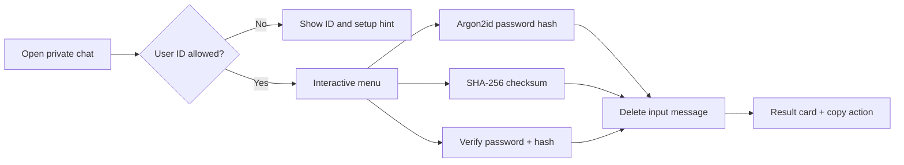

# HashGuard Telegram Bot


A privacy-minded Telegram toolbox for creating Argon2id password hashes, generating SHA-256
checksums, and verifying passwords against existing Argon2 hashes.

[راهنمای فارسی](docs/README.fa.md)

## Highlights

- Interactive inline-keyboard interface with compact, editable cards
- Argon2id password hashing with a unique random salt on every run
- SHA-256 checksums for non-password data
- Two-step password verification flow with immediate in-memory cleanup
- Native Telegram copy button for generated values
- Private-chat enforcement and user-ID allowlist
- Best-effort deletion of messages containing sensitive input
- No application database and no logging of user-provided values
- Docker deployment, automated tests, linting, type checks, and GitHub Actions CI

## User flow



## Why two algorithms?

| Use case | Algorithm | Reason |
|---|---|---|
| Store a password verifier | Argon2id | Salted, intentionally expensive, and memory-hard |
| Check file or data integrity | SHA-256 | Deterministic and fast |

SHA-256 is deliberately not presented as a password-storage option. Argon2id outputs include
the algorithm, parameters, salt, and digest, so the complete encoded string can be stored in a
`VARCHAR(255)` column.

## Project structure

```text
src/hash_bot/
├── bot.py          # application assembly and process entry point
├── config.py       # environment parsing and validation
├── handlers.py     # Telegram commands and conversation flows
├── hashing.py      # framework-independent hashing domain logic
├── keyboards.py    # inline keyboard components
└── texts.py        # user-facing Persian copy
```

Telegram-specific code is kept out of the hashing module, which makes the security-sensitive
logic easy to test without network access.

## Quick start

### 1. Create a Telegram bot

Open the official [BotFather](https://t.me/BotFather), run `/newbot`, and keep the returned token
private. It is also recommended to disable group joins with `/setjoingroups`.

### 2. Install

```powershell
py -m venv .venv
.\.venv\Scripts\Activate.ps1
python -m pip install -e ".[dev]"
Copy-Item .env.example .env
```

Add only the token to `.env` at first:

```dotenv
TELEGRAM_BOT_TOKEN=replace_with_your_token
ALLOWED_USER_IDS=
DELETE_INPUT_MESSAGES=true
MAX_INPUT_LENGTH=4096
```

### 3. Bootstrap private access

```powershell
hashguard
```

Send `/id` to the bot. Stop it, place the returned numeric ID in `ALLOWED_USER_IDS`, and start it
again. An empty allowlist keeps all hashing features locked; only the ID/setup flow remains
available.

Multiple owners can be separated with commas:

```dotenv
ALLOWED_USER_IDS=123456789,987654321
```

## Commands

| Command | Action |
|---|---|
| `/start` | Open the interactive menu |
| `/hash` | Start an Argon2id hashing flow |
| `/sha256` | Start a SHA-256 checksum flow |
| `/verify` | Compare a password with an encoded Argon2 hash |
| `/id` | Display the current Telegram user ID |
| `/cancel` | Clear temporary state and return to the menu |

Plain text sent outside a flow is treated as an Argon2id password input for quick access.

## Docker

```bash
docker compose up -d --build
docker compose logs -f bot
```

The container runs as an unprivileged user with a read-only filesystem and a small temporary
filesystem. The bot uses long polling and does not need an exposed port.

## Development

```powershell
ruff check .
mypy
pytest --cov=hash_bot --cov-report=term-missing
```

CI runs the same quality gates on every pull request and rejects accidentally tracked local
environment or virtual-environment paths.

## Security boundaries

HashGuard deletes input messages on a best-effort basis, but a message must reach Telegram and
the bot before it can be deleted. Do not use it for production passwords, private keys, recovery
codes, or other high-value secrets. Production password hashing belongs inside the application
backend. See [SECURITY.md](SECURITY.md) for the deployment checklist.

## License

Released under the [MIT License](LICENSE).

